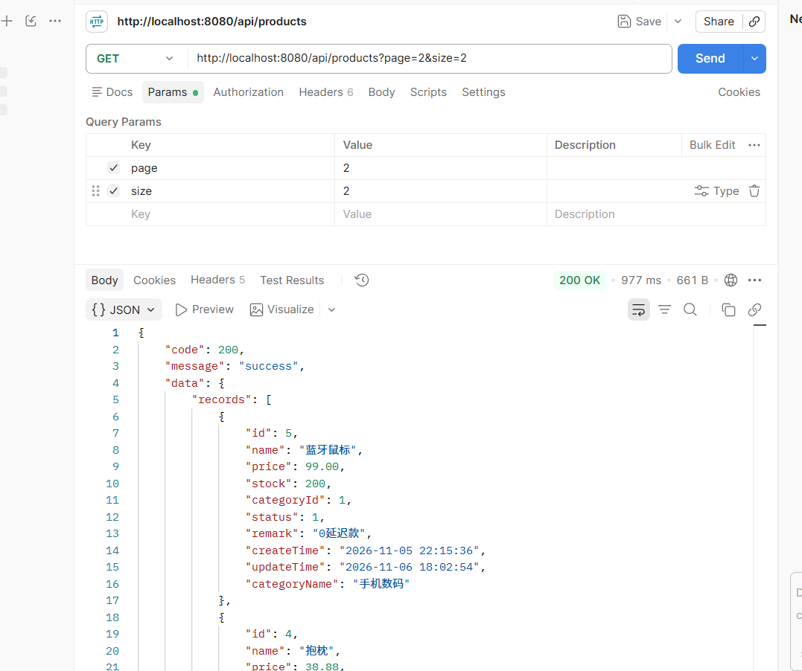
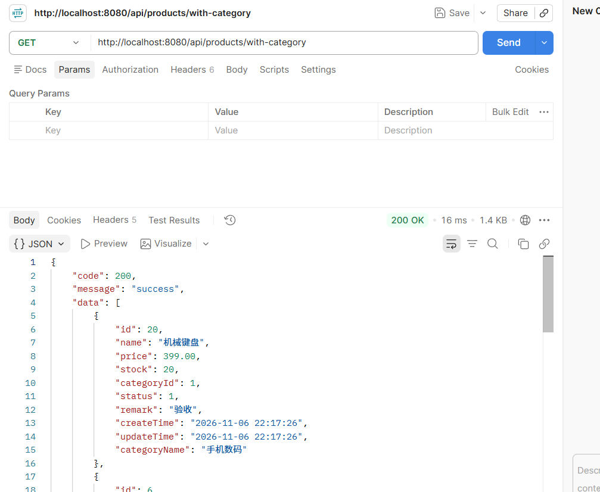
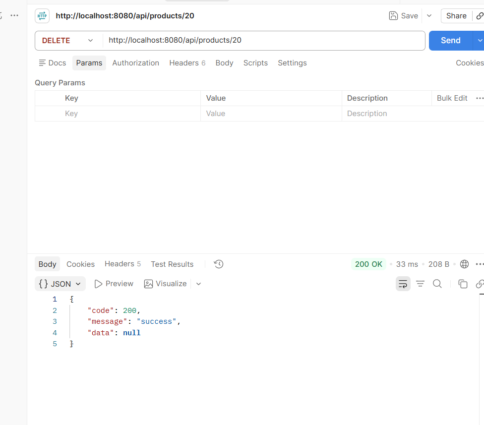
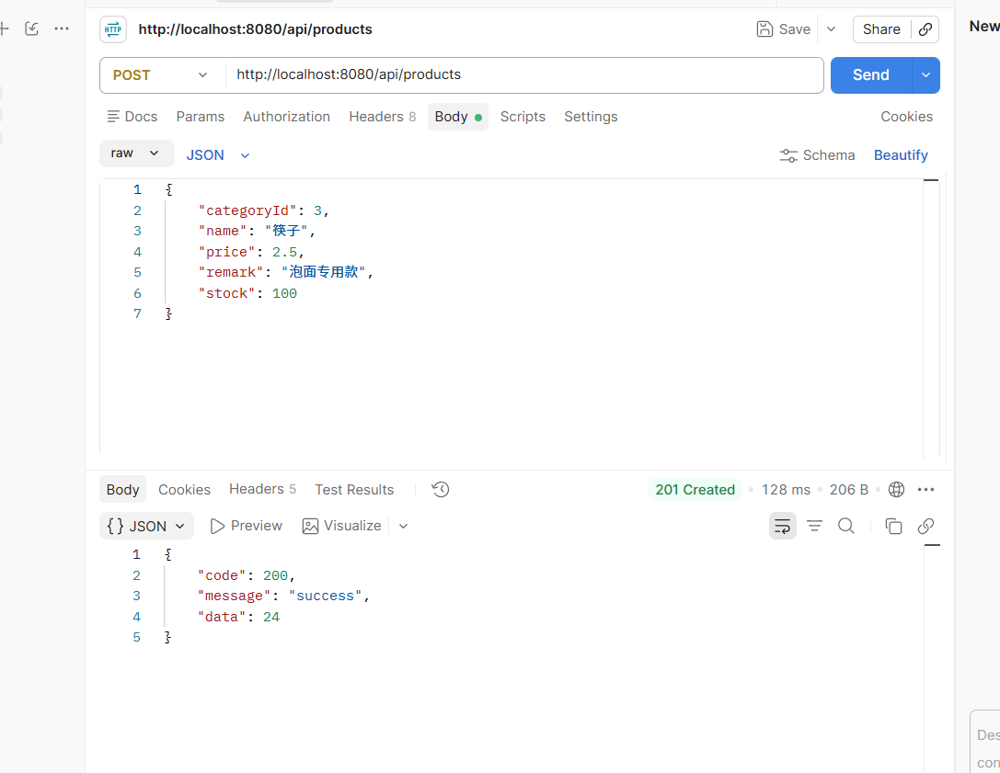
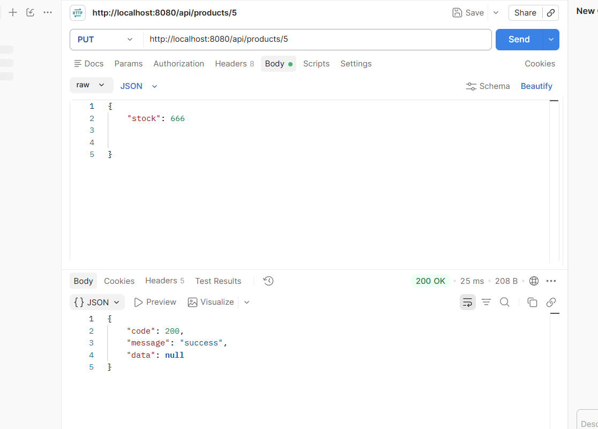

# 商品管理 API 接口测试说明

> 项目：product-admin（Java 后端初期考核）
> 测试日期：2026-11-07
> 测试工具：Postman + curl
> 服务地址：http://localhost:8080

## 1. 测试环境

| 项目 | 说明 |
|---|---|
| 操作系统 | Windows 11 |
| JDK | 17.0.2 |
| 框架 | Spring Boot 3.3.5 + MyBatis-Plus 3.5.5 |
| 数据库 | MySQL 8.0.44，库名 `demo_db` |
| 构建 | Maven 3.9.9 |
| 接口工具 | Postman（集合见 `postman/`），curl 辅助验证 |

## 2. 启动与准备

1. 执行建库脚本（可重复执行）：

   ```bash
   mysql -uroot -p < sql/init.sql
   ```

2. 按本机账号修改 `src/main/resources/application.yml` 的 `username/password`。

3. 构建并启动：

   ```bash
   mvn clean package -DskipTests
   java -jar target/product-admin-1.0.0.jar
   ```

4. 健康检查：`GET http://localhost:8080/api/hello`，应返回 `hello backend`。

5. Postman 导入 `postman/商品管理.postman_collection.json` 与
   `postman/backend-local.postman_environment.json`，选择环境 `backend-local`。

## 3. 测试用例与结果

| 编号 | 用例 | 请求 | 预期 | 实测 |
|---|---|---|---|---|
| T01 | 健康检查 | `GET /api/hello` | 200，`hello backend` | 通过 |
| T02 | 分页查询 | `GET /api/products?page=2&size=2` | 200，第 2 页 2 条 | 通过（截图 1） |
| T03 | 名称模糊 | `GET /api/products?name=蓝牙` | 200，命中 2 条 | 通过 |
| T04 | 分类筛选 | `GET /api/products?categoryId=3` | 200，仅家居用品 | 通过 |
| T05 | 价格区间 | `GET /api/products?minPrice=100&maxPrice=200` | 200，仅 199 元耳机 | 通过 |
| T06 | 商品详情 | `GET /api/products/1` | 200，含 `categoryName` | 通过 |
| T07 | 详情不存在 | `GET /api/products/999999` | HTTP 404，`code=404` | 通过 |
| T08 | 新增商品 | `POST /api/products` | HTTP 201，返回新 id | 通过（截图 4，id=24） |
| T09 | 新增重名 | 同上，名称重复 | 400，`商品名称已存在` | 通过 |
| T10 | 新增价格非法 | `price=0` 或 `-5` | 400，`商品金额必须大于0` | 通过 |
| T11 | 新增分类不存在 | `categoryId=9999` | 400，`分类不存在` | 通过 |
| T12 | 新增名称为空 | `name=""` | 400，`商品名称不能为空` | 通过 |
| T13 | 非法 JSON | 请求体 `{bad json}` | 400，`请求体格式不正确` | 通过 |
| T14 | 修改商品 | `PUT /api/products/5` | 200 | 通过（截图 5） |
| T15 | 局部修改 | `PUT /api/products/5`，仅 `stock` | 200，其余字段不变 | 通过 |
| T16 | 修改不存在 | `PUT /api/products/999999` | 404 | 通过 |
| T17 | 删除商品 | `DELETE /api/products/20` | 200，库中删除 | 通过（截图 3） |
| T18 | 重复删除 | 同上再次请求 | 404，`商品不存在` | 通过 |
| T19 | 分类列表 | `GET /api/categories` | 200，3 条 | 通过 |
| T20 | 新增分类 | `POST /api/categories` | 201，返回新 id | 通过 |
| T21 | 分类重名 | 同上，名称重复 | 400，`分类名称已存在` | 通过 |
| T22 | 删除有商品的分类 | `DELETE /api/categories/1` | 400，提示还有 N 个商品 | 通过 |
| T23 | 删除不存在的分类 | `DELETE /api/categories/9999` | 404，`分类不存在` | 通过 |
| T24 | 未知路径 | `GET /api/nope` | 404，`接口不存在` | 通过 |
| T25 | 路径参数类型错误 | `GET /api/products/abc` | 400，`参数 'id' 类型错误` | 通过 |
| T26 | 页码非法 | `GET /api/products?page=0` | 400，`页码必须大于0` | 通过 |
| T27 | 每页条数越界 | `GET /api/products?size=200` | 400，`每页最多100条` | 通过 |
| T28 | 多表关联列表 | `GET /api/products/with-category` | 200，每条含 `categoryName` | 通过（截图 2） |

## 4. 关键接口实测记录

### 4.1 分页 + 多条件（T02）

请求：`GET /api/products?page=2&size=2`

响应要点：`code=200`；`data.records` 为第 2 页的 2 条记录；`data.total` 为总数；
每条记录带 `categoryName`，时间格式为 `yyyy-MM-dd HH:mm:ss`（无 `T`）。



### 4.2 多表关联（T28 / T06）

请求：`GET /api/products/with-category`

响应要点：`LEFT JOIN category` 生效，`机械键盘` 记录返回
`"categoryName": "手机数码"`；详情接口 `GET /api/products/{id}` 同样返回该字段。



### 4.3 删除（T17）

请求：`DELETE /api/products/20`

响应：HTTP 200，`{"code":200,"message":"success","data":null}`；
再次删除同一 id 返回 HTTP 404，验证“删除前先判断存在”。



### 4.4 新增（T08）

请求：`POST /api/products`，Body 为商品 JSON。

响应：HTTP 201 Created，`data` 为新生成的主键（本次为 24），
可用 `GET /api/products/24` 复查。



### 4.5 修改（T14 / T15）

请求：`PUT /api/products/5`

响应：HTTP 200，`{"code":200,"message":"success","data":null}`；
支持只传 `stock` 等单个字段做局部更新。



## 5. 关键验证点

1. **HTTP 状态码与业务码一致**：成功 200/201，参数或业务校验失败 400，资源不存在 404，未预期异常 500。
2. **统一返回结构**：所有响应均为 `{code, message, data}`，错误响应不含堆栈。
3. **多表关联**：商品列表/详情返回 `categoryName`，分类为空的商品该字段为 `null`。
4. **分页字段**：`records / total / size / current / pages` 完整，排序按 id 倒序。
5. **参数校验**：注解校验（`@NotBlank`、`@NotNull`、`@DecimalMin`、`@Min/@Max`）与业务校验（重名、分类存在）双重生效。
6. **删除保护**：分类下还有商品时拒绝删除，避免破坏外键。
7. **日期格式**：`@JsonFormat` 输出 `yyyy-MM-dd HH:mm:ss`。

## 6. Postman 集合使用

按集合顺序执行即可完成一轮回归：

```text
列表（分页） → 单个 → 新增（自动写入 productId） → 修改 → 删除
→ 404 异常 → 分类列表 → 分类新增 → 分类删除（有商品，期望 400）
```

集合断言覆盖：状态码、统一结构、`categoryName`、404、分类删除保护。

## 7. 结论

28 条用例全部通过，商品/分类的增删改查、分页多条件、多表关联、参数校验与异常处理均符合预期。
截图 5 张为 Postman 实测记录，存放于 `doc/screenshots/`。

已知限制：未做登录鉴权；无单元测试，以本测试说明与 Postman 集合作为验收依据；
`application.yml` 中数据库密码为本地示例，公开仓库前应改为环境变量。